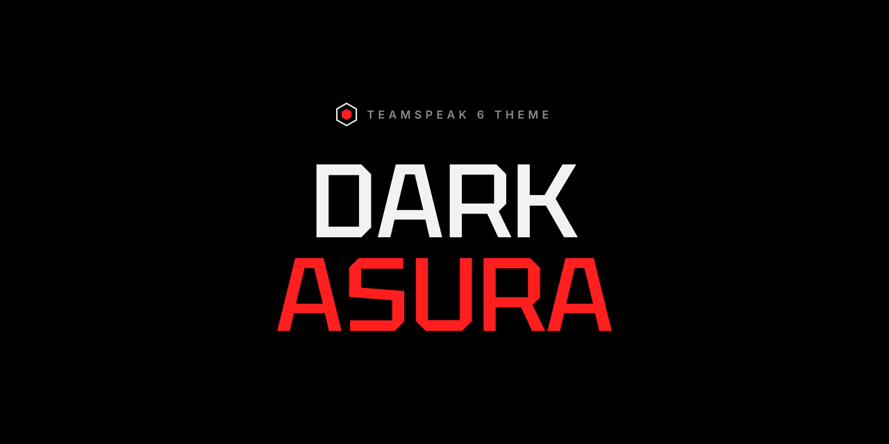
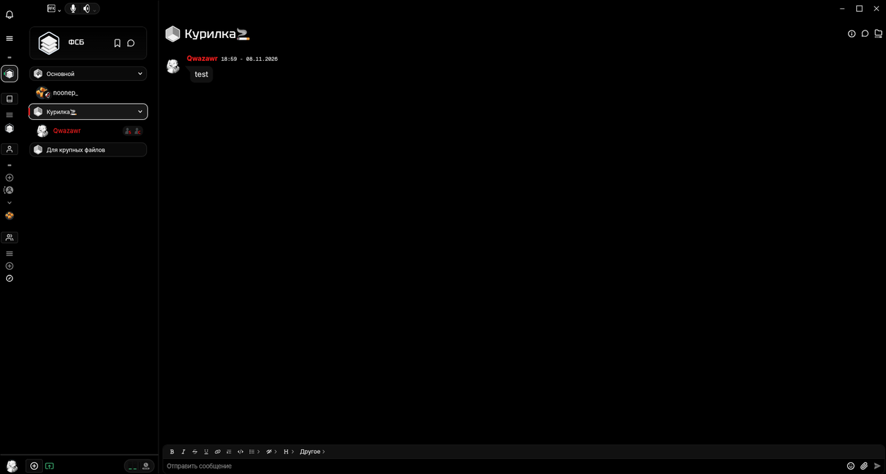
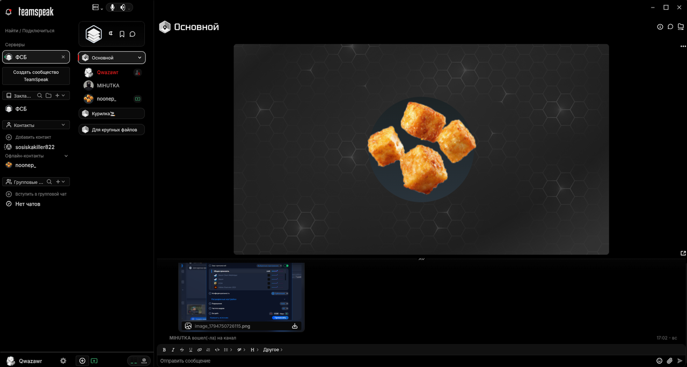

# Dark Asura

A pure black theme for the TeamSpeak 6 client: AMOLED black background, light controls, and red used only where it means something (your nickname, the active channel, AFK, errors).





## Installation

1. Download this repository: green **Code** button → **Download ZIP**, or clone it:
   ```
   git clone https://github.com/I-Asura-I/Dark-Asura-Theme-for-TeamSpeak-6.git
   ```
2. Copy the **`asura.dark.asura`** folder (not the whole repository) into the TeamSpeak extensions folder:

   | System  | Extensions folder |
   |---------|-------------------|
   | Windows | `%APPDATA%\TeamSpeak\Default\extensions` |
   | Linux   | `~/.config/TeamSpeak/Default/extensions` |
   | macOS   | `~/Library/Preferences/TeamSpeak/Default/extensions` |

   You can also open this folder from the client: **Settings → Appearance**, folder icon next to the theme list.

   The folder name must stay `asura.dark.asura`, otherwise TeamSpeak will not load the theme.
3. In TeamSpeak open **Settings → Appearance**, press the reload button (or restart the client) and select **Dark Asura**.

## Updating

Replace the `asura.dark.asura` folder with the new version and reload themes in **Settings → Appearance**.

## Customizing

All colors are defined once at the top of `asura.dark.asura/dark-asura.css` (variables starting with `--da-`). For example, change `--da-red` and `--da-red-rgb` to use a different accent color.

## License

- Theme: [MIT](LICENSE)
- Fonts: [Inter](asura.dark.asura/OFL-Inter.txt), [Tektur](asura.dark.asura/OFL-Tektur.txt) and [Geist Mono](asura.dark.asura/OFL-GeistMono.txt), all under the SIL Open Font License 1.1

## Credits

Made with help from Claude (Anthropic).

Not affiliated with TeamSpeak Systems GmbH.
